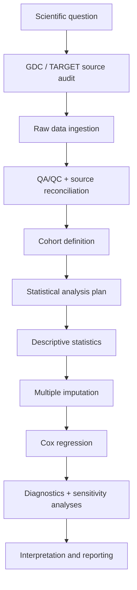
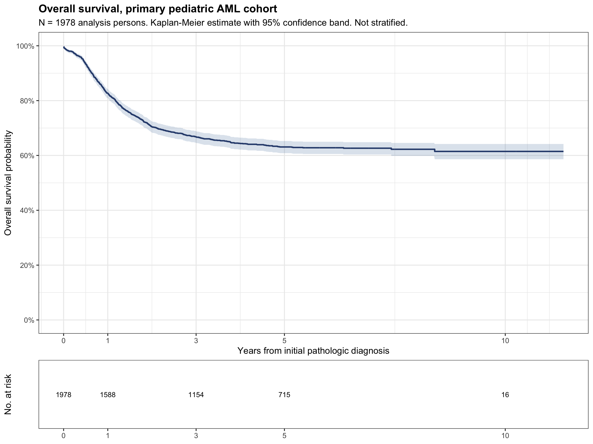
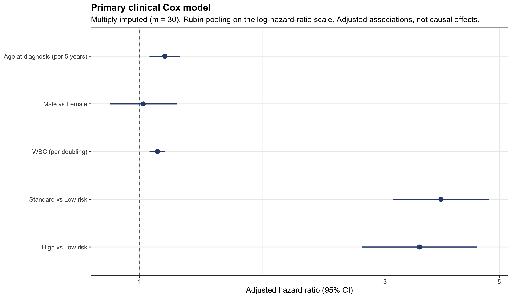
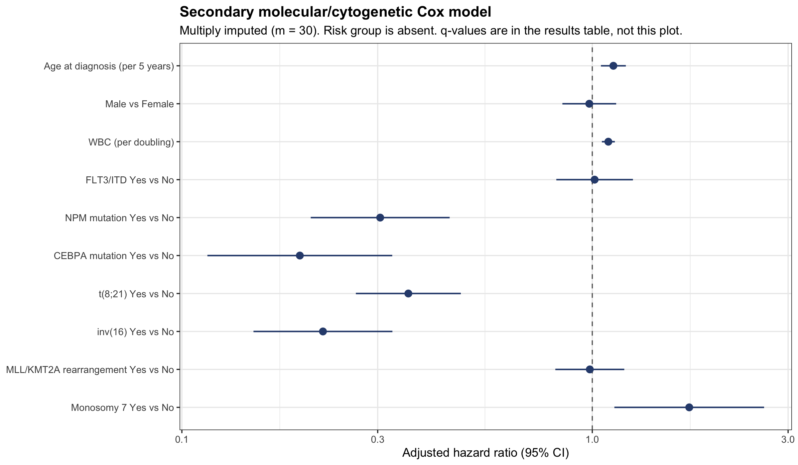
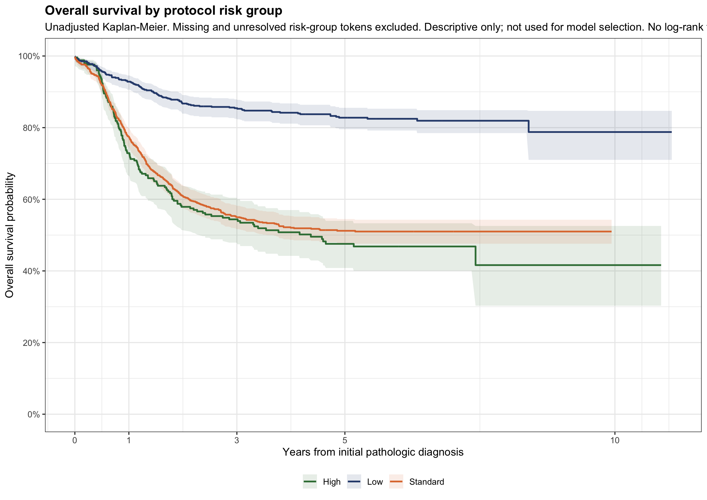

# PediaStat

An end-to-end applied biostatistics study of overall survival in pediatric acute myeloid leukemia using public NCI TARGET-AML clinical data.

PediaStat is a self-directed analysis that follows a scientific question through source validation, data QA/QC, cohort construction, statistical analysis planning, survival analysis, missing-data handling, diagnostics, and interpretation. It is an observational prognostic association study, not a machine-learning platform, clinical decision tool, or validated prediction model.


## Study motivation

Pediatric AML is a useful setting for studying overall survival with heterogeneous baseline clinical and molecular characteristics. Public TARGET-AML data contain those variables, but they are spread across the GDC Cases API and overlapping clinical supplements, with inconsistent identifiers and more than one representation of follow-up time.

The analysis therefore focuses on the full workflow required to move from heterogeneous public clinical sources to a prespecified, reproducible survival analysis: source audit and reconciliation, a frozen cohort and endpoint, a written analysis plan, Kaplan–Meier and Cox models, multiple imputation, and documented diagnostics and limitations.


## Scientific question

> Among children and adolescents with acute myeloid leukemia, which baseline patient and disease characteristics are associated with overall survival?

This is an observational prognostic association analysis. It does **not** estimate causal effects of intervening on a covariate, protocol, or treatment.


## Study workflow




## Data

**Source:** NCI Genomic Data Commons [TARGET-AML](https://gdc.cancer.gov/content/target-aml-publication-summary) (open clinical data only).

| Item | Count |
| --- | ---: |
| Original GDC cases | 2,492 |
| Primary analysis cohort | 1,978 patients diagnosed before age 18 |
| Deaths | 695 |
| Censored | 1,283 |

Normalized GDC clinical data supplied survival and demographic information. Seven open TARGET clinical-supplement workbooks supplied AML-specific baseline characteristics that are sparsely populated in the GDC Cases API. Overlapping sources were reconciled with documented source-precedence rules. GDC was the primary source for the overall-survival endpoint after some supplement OS-time fields were found to be discordant.

Patient-level raw files and analysis extracts are intentionally not committed. This repository does not use controlled-access data.

Details: [source audit](docs/target_aml_source_audit.md), [reconciliation report](docs/target_aml_reconciliation_report.md), [covariate source rules](docs/baseline_covariate_source_rules.md).


## Cohort construction

Ambiguous experimental, cell-line, and non-patient identifiers were excluded rather than guessed. Eighteen persons with multiple compatible GDC cases were deterministically consolidated. Predictor completeness was not used to determine cohort membership. Unknown or missing vital status was not coded as censoring.

```text
2,492 GDC cases
    ↓  exclude 138 experimental / non-patient / ambiguous identifiers
2,354 valid patient-identity cases
    ↓  consolidate biospecimen-level duplicates
2,315 unique valid analysis persons
    ↓
2,152 with a GDC diagnosis
    ↓
2,121 with age at diagnosis
    ↓
1,978 diagnosed before age 18
    ↓
1,978 with a valid overall-survival endpoint
```

Identity rules and endpoint definitions are in [primary cohort specification](docs/primary_cohort_specification.md).


## Statistical approach

Full specification: [inferential model specification](docs/inferential_model_specification.md) and [statistical analysis plan](docs/statistical_analysis_plan.md).

**Overall survival.** Kaplan–Meier estimation from initial pathologic diagnosis.

**Follow-up.** Reverse Kaplan–Meier estimator of potential follow-up.

**Primary clinical model.** Cox proportional hazards regression:

```r
Surv(os_days, os_event) ~ age5 + sex_std + log2_wbc + risk_group_std
```

Age is reported per 5-year increase. WBC is reported per doubling. Sex reference is Female. Risk-group reference is Low.

**Secondary model.** Cox regression with molecular and cytogenetic indicators (FLT3/ITD, NPM, CEBPA, t(8;21), inv(16), MLL/KMT2A, monosomy 7), adjusted for age, sex, and WBC. Protocol risk group is omitted because it already incorporates some of the same biological information.

**Missing data.** Multiple imputation by chained equations (MICE; 30 imputations, 20 iterations, seed 20260814). The imputation model included the event indicator and a Nelson–Aalen cumulative hazard. Survival time and event status were not imputed.

**Sensitivity and diagnostics.** Complete-case models; nonlinear age and WBC spline checks; proportional-hazards diagnostics using Schoenfeld residuals; influence diagnostics. An additional 100-iteration MICE continuation evaluated the stability of the original 20-iteration results; it was not part of the primary analysis. No stepwise selection or Cox-model interactions were used.

Ingestion, identifier validation, and cohort construction are implemented in Python with PostgreSQL (`raw` / `staging` / `analytics`). Descriptive and inferential analysis are implemented in R using `survival` and `mice`. Reports are written as Quarto documents.


## Key findings

- Overall 5-year survival was approximately 63% (95% CI 60.8%–65.3%). Median overall survival was not reached. Reverse Kaplan–Meier median potential follow-up was 5.39 years (95% CI 5.29–5.49).
- Both Standard and High protocol risk groups had substantially higher adjusted hazards than Low risk (global risk-group test *p* = 3.7×10⁻³²). The point estimates do not support describing a monotonic Standard < High progression.
- Higher baseline WBC was associated with higher hazard (adjusted HR 1.08 per doubling; 95% CI 1.05–1.12).
- Age showed a modest positive association with hazard (adjusted HR 1.12 per five years; 95% CI 1.05–1.20).
- In the secondary model, NPM, CEBPA, t(8;21), and inv(16) were associated with lower adjusted hazard. Monosomy 7 was associated with higher adjusted hazard. FLT3/ITD was compatible with no association.

These are prognostic associations, not causal effects.

### Primary clinical model

| Predictor | Adjusted HR | 95% CI |
| --- | ---: | ---: |
| Age per 5 years | 1.12 | 1.05–1.20 |
| Male vs Female | 1.02 | 0.88–1.18 |
| WBC per doubling | 1.08 | 1.05–1.12 |
| Standard vs Low risk | 3.85 | 3.10–4.78 |
| High vs Low risk | 3.50 | 2.71–4.53 |

> Hazard ratios represent adjusted prognostic associations and should not be interpreted causally. WBC showed minor proportional-hazards departures in both models, so its fitted hazard ratio should not be assumed constant throughout follow-up.

Descriptive concordance for the primary model was 0.658. That statistic was not optimized and is not evidence of a validated prediction model.

Secondary-model biological results, complete-case comparisons, and diagnostics are in the [inferential report](reports/inferential_analysis.qmd).


## Key figures

**Overall survival, primary cohort**



**Primary clinical Cox model**



**Secondary molecular/cytogenetic Cox model**



**Unadjusted survival by protocol risk group (descriptive only)**



Diagnostic plots, spline sensitivities, and additional tables are in `artifacts/inference/` and the inferential report.


## Statistical integrity

- The cohort and overall-survival endpoint were frozen before any predictor–survival analysis.
- Primary and secondary model specifications were frozen before Cox fitting.
- No stepwise selection was performed. No variable was added or removed because of a *p*-value.
- Multiple imputation was the prespecified primary missing-data method; complete-case analysis was a sensitivity analysis. The 100-iteration MICE continuation was a separate, post-analysis diagnostic and did not replace the frozen 20-iteration results.
- All 30 completed-dataset Cox fits for each model were checked for the expected 1,978 patients and 695 deaths.
- The secondary-model FDR family was specified before results were seen.
- Proportional-hazards remediation rules were specified before diagnostics. WBC departures in both Cox models were classified as minor; no material PH violation or remediation was recorded.
- The one recorded SAP deviation (collapsed auxiliary race categories in the MICE model) occurred before hazard ratios were viewed and is documented in [analysis_deviations.md](docs/analysis_deviations.md).


## Limitations

- Observational analysis; associations are not causal effects.
- The public TARGET-AML population may not generalize to all pediatric AML populations.
- Baseline clinical information came from multiple overlapping public supplements.
- Some candidate covariates were missing. Multiple imputation uses a Missing At Random working assumption that was not proven.
- Several categorical MICE chains were still drifting at the original 20 iterations. In a separate continuation to 100 iterations, the largest absolute change in a pooled hazard ratio was 2.38%, without changes in coefficient directions, confidence-interval null status, or secondary FDR decisions. This sensitivity is reassuring but does not establish convergence at iteration 20.
- Schoenfeld tests indicated time variation for WBC in both Cox models (primary *p* = 0.0108; secondary *p* = 0.0091). Both were classified as minor departures; the WBC hazard ratio need not be constant over time.
- Residual confounding is possible, including unmeasured disease biology and care access.
- Molecular and cytogenetic analyses are secondary. Some categories are sparse (for example, 38 monosomy 7 cases).
- No external validation was performed.
- Concordance is descriptive and is not evidence of a validated prediction model.
- The 10-year Kaplan–Meier risk set is small.


## Reproducibility

Aggregate tables and figures under [`artifacts/`](artifacts/) are committed. Patient-level raw files and extracts are not. Two tasks are separate: rendering those committed results, and reproducing the analysis from public TARGET-AML sources.

### Render the committed results

The Quarto sources [`reports/descriptive_analysis.qmd`](reports/descriptive_analysis.qmd) and [`reports/inferential_analysis.qmd`](reports/inferential_analysis.qmd) read the committed aggregate files. Rendering uses those files only. Run the commands from the repository root with the `pediastat-r` environment from step 2 active.

```bash
quarto render reports/descriptive_analysis.qmd --to html --output-dir reports
quarto render reports/inferential_analysis.qmd --to html --output-dir reports
```

Set `QUARTO_R` to the `R` executable in that same environment. On Intel macOS 13, the official Quarto installation may also need a compatible Sass executable in `QUARTO_DART_SASS`. That variable is optional on other systems.

If Quarto is missing or rendering fails, the R scripts write an abbreviated HTML substitute from those artifacts. That HTML is not the complete Quarto scientific report:

```bash
Rscript analysis/R/render_descriptive_report.R
Rscript analysis/R/render_inference_report.R
```

Rendered HTML is gitignored.

### Reproduce the analysis

Reproduction needs Python 3.12 or newer, PostgreSQL server binaries (`initdb`, `pg_ctl`, `createdb`, and `psql` on `PATH`, or `POSTGRES_BIN` set to that directory), Conda, and network access to the public GDC API. Run every command from the repository root.

1. Create a virtual environment named `.venv`. `make` uses `.venv/bin/python` when that interpreter exists.

   ```bash
   python3 -m venv .venv
   source .venv/bin/activate
   python -m pip install -e ".[dev]"
   ```

2. Create the R environment named `pediastat-r` from [`analysis/R/environment.yml`](analysis/R/environment.yml):

   ```bash
   conda env create -f analysis/R/environment.yml
   conda activate pediastat-r
   ```

   `make` uses `$HOME/miniconda3/envs/pediastat-r/bin/Rscript` when that file exists, and the Quarto binary beside it when `quarto --version` prints a version. Otherwise it uses `Rscript` and the first `quarto` on `PATH` that prints a version. It sets `QUARTO_R` to the `R` executable next to the selected `Rscript`. Activate `pediastat-r`, or pass `RSCRIPT` and `QUARTO`, when the environment lives somewhere else. If `QUARTO_DART_SASS` is set, `make` passes it through to Quarto. Details are in [analysis/R/README.md](analysis/R/README.md).

3. Prepare environment variables. Copy [`.env.example`](.env.example) to `.env`. The project-local cluster uses host `localhost`, port **5433**, database `pediastat`, user `pediastat`, and an empty password (trust authentication on localhost). Python reads `.env` automatically. R reads `POSTGRES_HOST`, `POSTGRES_PORT`, `POSTGRES_DB`, `POSTGRES_USER`, and `POSTGRES_PASSWORD` from the process environment. When `POSTGRES_PORT` is unset, the R connection tries port 5433 and then 5432.

   ```bash
   cp .env.example .env
   ```

   To use an existing PostgreSQL server instead of the project-local cluster, set `POSTGRES_PORT` and `POSTGRES_PASSWORD` in `.env` and call `scripts/bootstrap_database.py`, `scripts/ingest_gdc_cases.py`, `scripts/ingest_target_aml_supplements.py`, `scripts/run_source_reconciliation.py`, and `scripts/build_primary_cohort.py` without `--local-cluster`. The `make` database targets always pass `--local-cluster`.

4. Initialize the project-local cluster. This creates `.pgdata`, listens on port 5433, and applies `sql/01_create_schemas.sql` through `sql/08_create_primary_cohort_extract_view.sql`.

   ```bash
   make db-bootstrap
   ```

5. Download the public clinical sources. This queries the GDC API, writes aggregate audit artifacts under `artifacts/source_audit/`, and saves the open clinical-supplement workbooks under `data/raw/gdc_open_clinical_supplements/` (gitignored).

   ```bash
   make audit
   ```

6. Ingest the clinical records. `make ingest` loads GDC Cases API entities, ingests each downloaded workbook, and runs source reconciliation. Each step passes `--local-cluster`, which reuses the cluster on port 5433.

   ```bash
   make ingest
   ```

7. Construct the validated primary cohort:

   ```bash
   make cohort
   ```

8. Run the descriptive analysis. This reads `analytics.primary_cohort_extract`, writes aggregate descriptive artifacts, and renders [`reports/descriptive_analysis.qmd`](reports/descriptive_analysis.qmd).

   ```bash
   make descriptive
   ```

9. Run the inferential analysis. This executes the frozen MICE specification (*m* = 30, 20 iterations), pools the primary and secondary Cox models, writes aggregate inferential artifacts, and renders [`reports/inferential_analysis.qmd`](reports/inferential_analysis.qmd). The separate 100-iteration convergence sensitivity is not part of `make inference`.

   ```bash
   make inference
   ```

When Quarto is unavailable or Quarto rendering fails, `make descriptive` and `make inference` write abbreviated HTML with `analysis/R/render_descriptive_report.R` and `analysis/R/render_inference_report.R`. Those files state that they are abbreviated substitutes, not the complete Quarto reports. A failure in the statistical scripts is not replaced by this fallback. If both Quarto and the fallback fail, `make` exits with an error.

### Environment check

```bash
make check
```

`make check` runs Ruff, pytest, and `scripts/check_environment.py`. It confirms the Python package, tests, and configuration. It does not connect to PostgreSQL, so an inactive database is not a failure.

Stack: Python, PostgreSQL (`raw` / `staging` / `analytics`), R, `survival`, `mice`.


## Repository map

| Path | Role |
| --- | --- |
| `src/pediastat/` | Python package for audit, ingestion, validation, and cohort construction |
| `analysis/R/` | R scripts for descriptive analysis, MICE, Cox models, and diagnostics |
| `sql/` | PostgreSQL schema and analytics-layer DDL |
| `docs/` | Analysis plan, cohort rules, source audit, and decision log |
| `reports/` | Quarto reports |
| `artifacts/` | Aggregate tables and figures (no patient-level extracts) |

Specification documents include the [statistical analysis plan](docs/statistical_analysis_plan.md), [inferential model specification](docs/inferential_model_specification.md), and [project decisions](docs/project_decisions.md).
